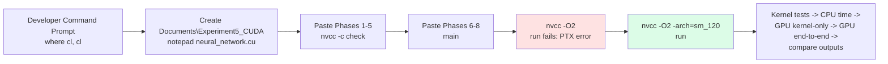
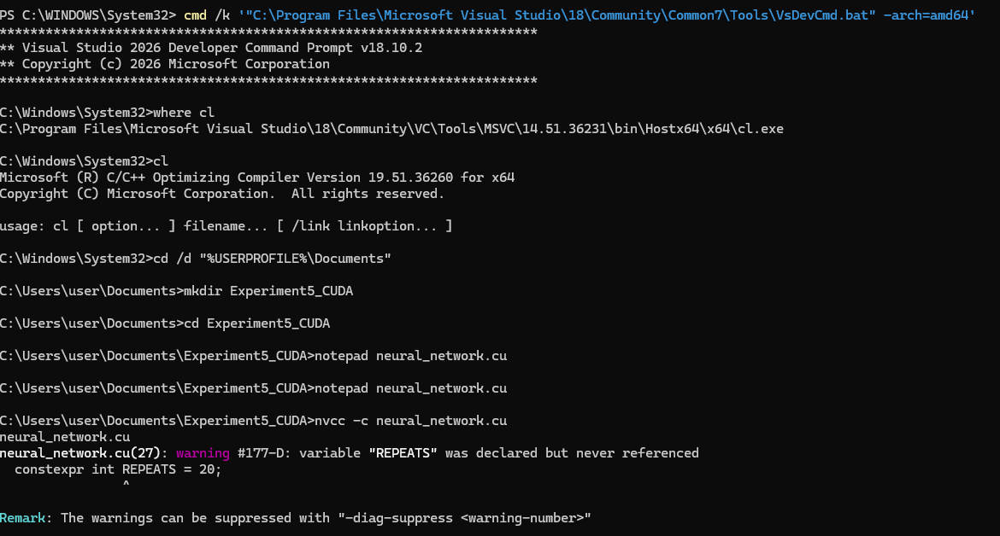
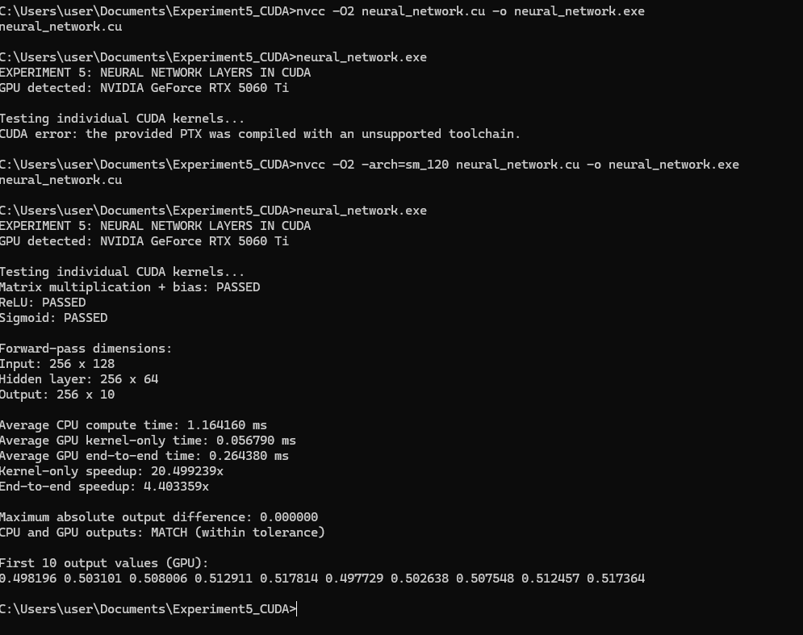
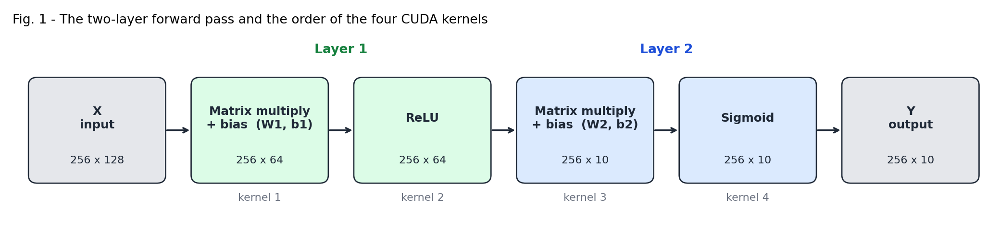
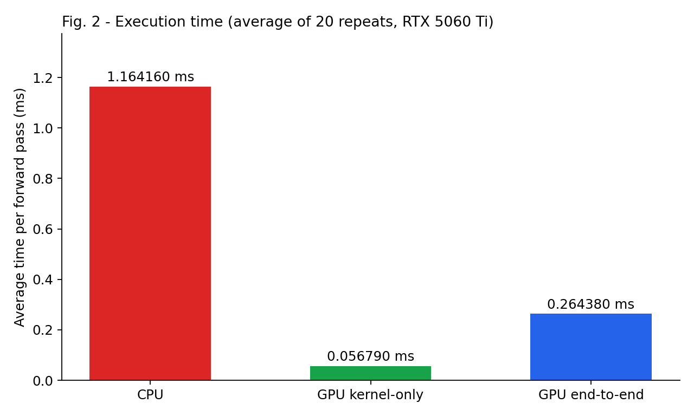
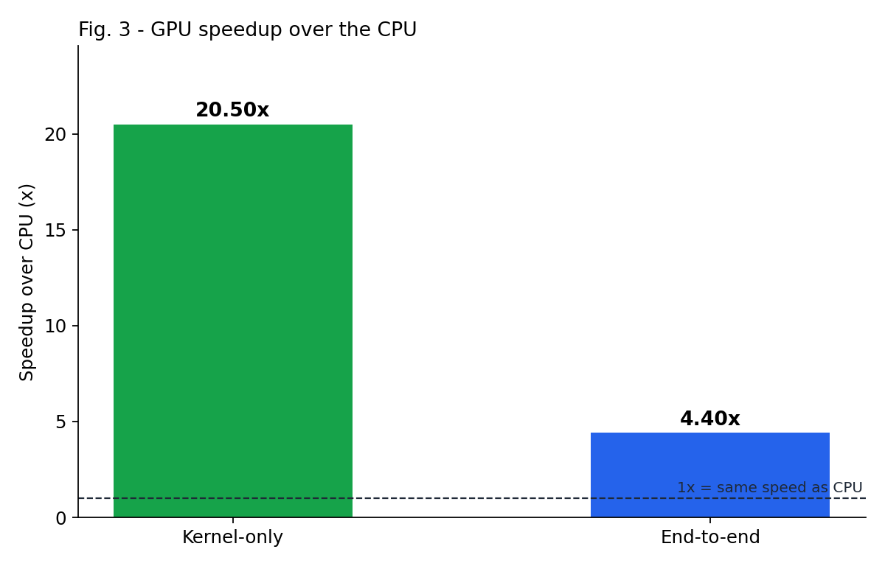
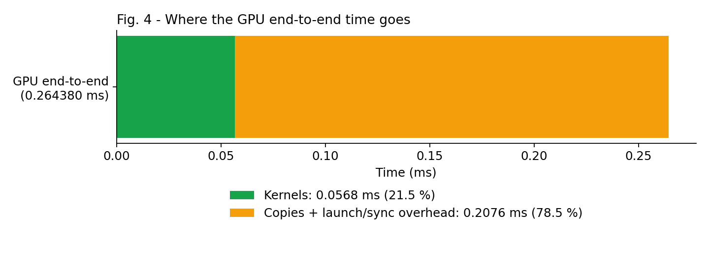
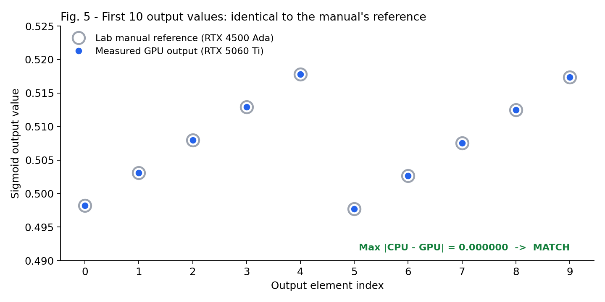
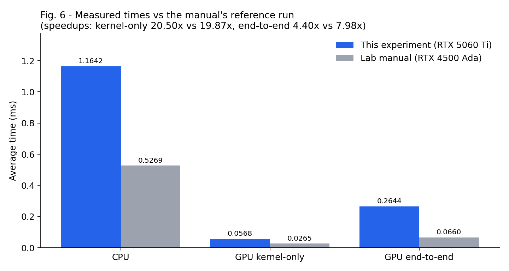

<div align="center">

# Experiment 5 — Neural Network Layers in CUDA
### Matrix Multiplication with Bias · ReLU · Sigmoid · CPU vs GPU Forward Pass

**Course:** Parallel Computing and GPU Programming (PGC) Laboratory
**Tools:** CUDA C++ (`nvcc -O2 -arch=sm_120`) · MSVC `cl.exe` (Visual Studio 2026 Developer Command Prompt)
**Platform:** Windows · NVIDIA GeForce RTX 5060 Ti


</div>

---

## Abstract

A neural network makes a prediction by passing data through **layers**. Each layer does a **matrix multiplication**, adds a **bias**, and applies an **activation function**. This experiment builds a small **two-layer network** in CUDA with three custom kernels: **matrix multiplication + bias**, **ReLU** and **sigmoid**. The same forward pass is also written as ordinary C++ on the CPU, so the two results can be compared.

The network takes **256 inputs of 128 values** each, passes them through a **hidden layer of 64 neurons** (ReLU) and an **output layer of 10 neurons** (sigmoid). It only does the **forward pass (inference)**: there is no training.

Results on an **NVIDIA GeForce RTX 5060 Ti** (average of 20 repeats):

- All **three kernel tests PASSED**, and the GPU output **matched the CPU output exactly** (maximum difference **0.000000**). The first 10 output values were **identical to the lab manual's reference**.
- **CPU:** 1.164160 ms · **GPU kernel-only:** 0.056790 ms · **GPU end-to-end:** 0.264380 ms
- **Kernel-only speedup: 20.50×** · **End-to-end speedup: 4.40×**
- About **78.5 %** of the GPU end-to-end time is spent copying data and on launch/synchronisation overhead, not on the kernels. That is why the end-to-end speedup is much lower than the kernel-only speedup.
- The first build failed at run time with `the provided PTX was compiled with an unsupported toolchain`. Building for the GPU's own architecture with **`-arch=sm_120`** fixed it.

---

## Table of Contents

1. [Introduction](#1-introduction)
2. [Aim and Objectives](#2-aim-and-objectives)
3. [Basic Concepts](#3-basic-concepts)
4. [Experimental Setup](#4-experimental-setup)
5. [Methodology and Workflow](#5-methodology-and-workflow)
6. [Environment Preparation](#6-environment-preparation)
7. [The Program (neural_network.cu)](#7-the-program-neural_networkcu)
8. [Build and Run](#8-build-and-run)
9. [Consolidated Results](#9-consolidated-results)
10. [Performance Analysis](#10-performance-analysis)
11. [Comparison](#11-comparison)
12. [Observations and Limitations](#12-observations-and-limitations)
13. [Troubleshooting and Issues Encountered](#13-troubleshooting-and-issues-encountered)
14. [Important Terms](#14-important-terms)
15. [Conclusion](#15-conclusion)
16. [Repository Structure and Reproduction](#16-repository-structure-and-reproduction)
17. [References](#17-references)

---

## 1. Introduction

The earlier experiments used CPU threads (OpenMP, Pthreads) and, in Experiment 1, a CUDA matrix multiplication. This experiment applies CUDA to the most common workload GPUs are used for today: **neural networks**.

A neural network layer is mostly **matrix multiplication**. Every output value of a layer can be computed **independently** of the others, which is exactly what a GPU is good at: it runs thousands of threads, one per output value.

```text
   X (256 x 128)
        |   Layer 1:  Z1 = X x W1 + b1      (matrix multiply + bias)
        |             A1 = ReLU(Z1)          (256 x 64)
        v
   A1 (256 x 64)
        |   Layer 2:  Z2 = A1 x W2 + b2     (matrix multiply + bias)
        |             Y  = Sigmoid(Z2)       (256 x 10)
        v
   Y (256 x 10)   <- the network's output
```

The program computes this forward pass **twice**: once on the CPU (plain loops) and once on the GPU (four CUDA kernels). It then checks that both give the same answer and compares the time each takes.

---

## 2. Aim and Objectives

**Aim** (from the lab manual): To implement and evaluate basic neural-network layers using custom CUDA kernels — matrix multiplication with bias, ReLU activation and sigmoid activation — execute the same forward pass on the CPU and GPU, validate numerical correctness, measure execution time and calculate GPU speedup.

**Objectives:**

1. Explain CUDA kernels, blocks, threads and grid dimensions.
2. Implement **matrix multiplication with bias** in CUDA.
3. Implement **ReLU** and **sigmoid** activation kernels.
4. Allocate memory on the GPU and **transfer data** between host (CPU) and device (GPU).
5. **Compare** the CPU and GPU outputs.
6. **Measure** execution time and calculate **speedup**.

---

## 3. Basic Concepts

### 3.1 CUDA terms

| Term | Meaning |
|:--|:--|
| **Host / device** | The CPU and its memory / the GPU and its memory |
| **Kernel** | A function marked `__global__` that runs on the GPU, once per thread |
| **Thread** | One copy of the kernel; here, one thread computes **one output value** |
| **Block** | A group of threads (here 16 × 16 = 256 or 256 × 1) |
| **Grid** | All the blocks of one kernel launch |
| `threadIdx`, `blockIdx`, `blockDim` | The thread's position in its block, the block's position in the grid, and the block size |
| **Global index** | `blockIdx.x * blockDim.x + threadIdx.x`: which element this thread works on |
| **Boundary check** | `if (idx < count)`: grids are rounded up to whole blocks, so some threads have no element and must do nothing |

### 3.2 The three layers

| Operation | Formula | One thread does |
|:--|:--|:--|
| **Matrix multiply + bias** | `C[row, col] = Σₖ A[row, k] × B[k, col] + bias[col]` | One output element (a dot product of length K) |
| **ReLU** | `ReLU(x) = max(0, x)` | One element: negatives become 0 |
| **Sigmoid** | `Sigmoid(x) = 1 / (1 + e^(−x))` | One element: squeezed into (0, 1) |

### 3.3 Network configuration

| Constant | Value | | Tensor | Shape |
|:--|:-:|:-:|:--|:--|
| `BATCH` | 256 | | X (input) | 256 × 128 |
| `INPUT_SIZE` | 128 | | W1, b1 | 128 × 64, 64 |
| `HIDDEN_SIZE` | 64 | | Hidden activation | 256 × 64 |
| `OUTPUT_SIZE` | 10 | | W2, b2 | 64 × 10, 10 |
| `REPEATS` | 20 | | Output Y | 256 × 10 |

The inputs and weights are made with fixed `sin`/`cos` formulas, so every computer gets **exactly the same data**, and therefore the same output.

### 3.4 Formulas

| Metric | Formula |
|:--|:--|
| Kernel-only speedup | $\dfrac{T_{\text{CPU}}}{T_{\text{GPU kernel-only}}}$ |
| End-to-end speedup | $\dfrac{T_{\text{CPU}}}{T_{\text{GPU end-to-end}}}$ |
| Maximum absolute difference | $\max_i \lvert \text{CPU}_i - \text{GPU}_i \rvert$ — outputs **match** when it is below $10^{-4}$ |

---

## 4. Experimental Setup

### 4.1 Environment (from screenshots 01–02)

| Item | Value |
|:--|:--|
| GPU | **NVIDIA GeForce RTX 5060 Ti** (compute capability 12.0, built with `-arch=sm_120`) |
| Command prompt | **Visual Studio 2026 Developer Command Prompt v18.10.2**, `-arch=amd64` |
| C++ compiler | MSVC **19.51.36260** for x64 (tools 14.51.36231) |
| Compile command | `nvcc -O2 -arch=sm_120 neural_network.cu -o neural_network.exe` |
| Working folder | `C:\Users\user\Documents\Experiment5_CUDA` |
| Date | 19 November 2026 |
| NVIDIA driver / CUDA version (`nvidia-smi`) | Not captured |
| CUDA Toolkit version (`nvcc --version`) | Not captured |
| CPU model | Not captured |

### 4.2 Manual vs actual

| Item | Manual | Actual | Effect |
|:--|:--|:--|:--|
| Reference GPU | RTX 4500 Ada Generation | **RTX 5060 Ti** | Different timings (expected); outputs identical |
| Build tools | Visual Studio **2022** Build Tools | Visual Studio **2026** Community (v18.10.2) | None |
| Compile command | `nvcc -O2 neural_network.cu -o neural_network.exe` | Same, then **`-arch=sm_120` added** | Needed on this GPU (Section 13) |
| Setup checks (Section 6, Steps 1–3) | `nvidia-smi`, `nvcc --version`, `where.exe nvcc` | Not shown in the screenshots | Driver and toolkit versions unknown |
| Repeated runs (Section 8, Step 6) | Run 3 times, note the variation | **1 run** recorded | Run-to-run variation not measured |
| Source code | Manual's 8 phases | Same logic; shorter comments; the `CUDA_CHECK` message prints the error text without the file name and line number | No effect on results |

---

## 5. Methodology and Workflow



The program was written in Notepad phase by phase, as the manual describes. The two screenshots were renamed in execution order and saved in [`screenshots/`](screenshots); their text was typed into [`results/raw/`](results/raw), and the numbers into the CSV files in [`results/`](results).

---

## 6. Environment Preparation

| Step | Command | Purpose | Result |
|:-:|:--|:--|:--|
| 1 | `cmd /k "...\VsDevCmd.bat" -arch=amd64` | Open the Developer Command Prompt (puts `cl.exe` on PATH) | VS 2026 Developer Command Prompt v18.10.2 |
| 2 | `where cl` | Find the C++ compiler | `...\MSVC\14.51.36231\bin\Hostx64\x64\cl.exe` |
| 3 | `cl` | Check that it runs | Compiler 19.51.36260 for x64, `usage: cl ...` |
| 4 | `cd /d "%USERPROFILE%\Documents"`, `mkdir Experiment5_CUDA`, `cd Experiment5_CUDA` | Work in a writable folder (not System32) | `C:\Users\user\Documents\Experiment5_CUDA` |
| 5 | `notepad neural_network.cu` | Create the source file and paste the phases | File created |
| 6 | `nvcc -c neural_network.cu` | Compile check after Phase 5 | Compiled; one warning (below) |

**The warning in step 6 is expected.** `REPEATS` is declared in Phase 1 but only used in `main`, which is pasted later (Phases 6–8). The check only confirms that Phases 1–5 have no syntax errors.

<p align="center">
  <br>
  <em>01 — Developer Command Prompt, <code>where cl</code> / <code>cl</code>, the project folder, and the Phase 5 check <code>nvcc -c neural_network.cu</code>.</em>
</p>

---

## 7. The Program (`neural_network.cu`)

Full source: [`src/neural_network.cu`](src/neural_network.cu).

### 7.1 The eight phases

| Phase | Contents | What it does |
|:-:|:--|:--|
| 1 | Includes, `CUDA_CHECK`, constants | Libraries, stops on any CUDA error, sets the sizes |
| 2 | `matrixMulBiasKernel`, `reluKernel`, `sigmoidKernel` | The GPU kernels (one thread per output element) |
| 3 | `cpuMatMulBias`, `cpuReLU`, `cpuSigmoid`, `cpuForwardPass` | The same network on the CPU (the reference answer) |
| 4 | `launchGpuForwardPass`, `nearlyEqual` | Launches the 4 kernels in order; compares two floats |
| 5 | `testMatrixKernel`, `testReLUKernel`, `testSigmoidKernel` | Tests each kernel on tiny inputs with known answers |
| 6 | Start of `main` | Finds the GPU, runs the tests, creates the data, times the CPU |
| 7 | Middle of `main` | Allocates GPU memory, copies data, warm-up, times the GPU |
| 8 | End of `main` | Compares the outputs, prints the results, frees memory |

### 7.2 The kernels

```cpp
__global__ void matrixMulBiasKernel(const float* A, const float* B, const float* bias,
                                    float* C, int M, int N, int K)
{
    int row = blockIdx.y * blockDim.y + threadIdx.y;   // which output row
    int col = blockIdx.x * blockDim.x + threadIdx.x;   // which output column
    if (row < M && col < N) {                          // boundary check
        float sum = 0.0f;
        for (int k = 0; k < K; ++k)
            sum += A[row * K + k] * B[k * N + col];    // dot product
        C[row * N + col] = sum + bias[col];            // add the bias
    }
}

__global__ void reluKernel(float* values, int count)
{
    int idx = blockIdx.x * blockDim.x + threadIdx.x;
    if (idx < count) values[idx] = fmaxf(0.0f, values[idx]);
}

__global__ void sigmoidKernel(float* values, int count)
{
    int idx = blockIdx.x * blockDim.x + threadIdx.x;
    if (idx < count) values[idx] = 1.0f / (1.0f + expf(-values[idx]));
}
```

Matrices are stored **row by row** in one flat array, so element `[row, col]` of a matrix with `N` columns is at index `row * N + col`. ReLU and sigmoid work **in place**: they overwrite the matrix they read.

### 7.3 How many threads each kernel uses ([`results/launch_configuration.csv`](results/launch_configuration.csv))

| Step | Kernel | Grid | Block | Threads | Elements | Idle threads |
|:-:|:--|:-:|:-:|--:|--:|--:|
| 1 | matrix multiply + bias (layer 1) | 4 × 16 | 16 × 16 | 16,384 | 16,384 (256 × 64) | 0 |
| 2 | ReLU | 64 | 256 | 16,384 | 16,384 | 0 |
| 3 | matrix multiply + bias (layer 2) | 1 × 16 | 16 × 16 | 4,096 | 2,560 (256 × 10) | **1,536** |
| 4 | sigmoid | 10 | 256 | 2,560 | 2,560 | 0 |

**Why the boundary check matters:** in step 3 the output has only **10 columns**, but a block is **16 columns** wide. The 6 extra columns in every row are threads with no element. Without `if (row < M && col < N)` they would write outside the output array.

### 7.4 The kernel tests

| Test | Input | Expected | Result |
|:--|:--|:--|:-:|
| Matrix multiply + bias | A = [[1,2,3],[4,5,6]], B = [[1,2],[3,4],[5,6]], bias = [1, −1] | [[23, 27], [50, 63]] | **PASSED** |
| ReLU | [−2, 0, 3, −4, 5] | [0, 0, 3, 0, 5] | **PASSED** |
| Sigmoid | [−2, 0, 2] | ≈ [0.119203, 0.5, 0.880797] | **PASSED** |

Check of the first test by hand: row 1 · column 1 = 1·1 + 2·3 + 3·5 = **22**, plus bias 1 = **23**.

### 7.5 How the time is measured

| Measurement | Clock | What is inside |
|:--|:--|:--|
| **CPU** | `std::chrono::steady_clock` | 20 CPU forward passes, averaged |
| **Warm-up** | — | One GPU forward pass first, not timed (the first launch has one-time start-up cost) |
| **GPU kernel-only** | CUDA events (`cudaEventRecord`) | 20 runs of the 4 kernels, data **already on the GPU** |
| **GPU end-to-end** | `std::chrono::steady_clock` | 20 × (copy X, W1, b1, W2, b2 to the GPU → 4 kernels → wait → copy the output back) |

**CUDA events** are used for the kernels because a kernel launch returns immediately: the CPU clock would only measure the launch, not the work. Events are recorded on the GPU itself.

---

## 8. Build and Run

### 8.1 First build: run-time error

```text
> nvcc -O2 neural_network.cu -o neural_network.exe
neural_network.cu
> neural_network.exe
EXPERIMENT 5: NEURAL NETWORK LAYERS IN CUDA
GPU detected: NVIDIA GeForce RTX 5060 Ti

Testing individual CUDA kernels...
CUDA error: the provided PTX was compiled with an unsupported toolchain.
```

The program compiled, found the GPU, then stopped at the first kernel launch. The cause and fix are explained in [Section 13](#13-troubleshooting-and-issues-encountered).

### 8.2 Second build with `-arch=sm_120`: success

```text
> nvcc -O2 -arch=sm_120 neural_network.cu -o neural_network.exe
neural_network.cu
> neural_network.exe
EXPERIMENT 5: NEURAL NETWORK LAYERS IN CUDA
GPU detected: NVIDIA GeForce RTX 5060 Ti

Testing individual CUDA kernels...
Matrix multiplication + bias: PASSED
ReLU: PASSED
Sigmoid: PASSED

Forward-pass dimensions:
Input: 256 x 128
Hidden layer: 256 x 64
Output: 256 x 10

Average CPU compute time: 1.164160 ms
Average GPU kernel-only time: 0.056790 ms
Average GPU end-to-end time: 0.264380 ms
Kernel-only speedup: 20.499239x
End-to-end speedup: 4.403359x

Maximum absolute output difference: 0.000000
CPU and GPU outputs: MATCH (within tolerance)

First 10 output values (GPU):
0.498196 0.503101 0.508006 0.512911 0.517814 0.497729 0.502638 0.507548 0.512457 0.517364
```

<p align="center">
  <br>
  <em>02 — First build fails at run time (PTX error); rebuilt with <code>-arch=sm_120</code>: all tests PASSED, outputs MATCH.</em>
</p>

---

## 9. Consolidated Results

### 9.1 Observation table (manual Section 13)

| Measurement | Measured (RTX 5060 Ti) | Manual reference (RTX 4500 Ada) | Unit |
|:--|--:|--:|:-:|
| CPU average compute time | **1.164160** | 0.526860 | ms |
| GPU kernel-only time | **0.056790** | 0.026517 | ms |
| GPU end-to-end time | **0.264380** | 0.066010 | ms |
| Kernel-only speedup | **20.499239** | 19.868913 | × |
| End-to-end speedup | **4.403359** | 7.981518 | × |
| Maximum absolute difference | **0.000000** | 0.000000 | |
| Kernel validation | **All PASSED** | All PASSED | |
| CPU / GPU output validation | **MATCH** | MATCH | |
| GPU model | **NVIDIA GeForce RTX 5060 Ti** | NVIDIA RTX 4500 Ada Generation | |

Data: [`results/timing_results.csv`](results/timing_results.csv).

### 9.2 Speedups checked by hand (manual Section 8, Step 5)

| Speedup | Calculation | By hand | Printed |
|:--|:--|--:|--:|
| Kernel-only | 1.164160 ÷ 0.056790 | **20.4994** | 20.499239 |
| End-to-end | 1.164160 ÷ 0.264380 | **4.4034** | 4.403359 |

The last digits differ slightly because the printed times are rounded to 6 decimals, while the program divides the unrounded values.

### 9.3 Final checks (manual Section 8, Step 7)

| Question | Answer |
|:--|:-:|
| Did all three kernel tests say PASSED? | **Yes** |
| Is the maximum absolute difference below 0.0001? | **Yes** (0.000000) |
| Does the output say MATCH (within tolerance)? | **Yes** |
| Is the end-to-end time larger than the kernel-only time? | **Yes** (0.264380 > 0.056790 ms) |
| Is the end-to-end speedup lower than the kernel-only speedup? | **Yes** (4.40× < 20.50×) |

---

## 10. Performance Analysis

All graphs are made with **matplotlib** by [`scripts/generate_graphs.py`](scripts/generate_graphs.py) from the CSV files in `results/`. It also writes [`results/summary_metrics.csv`](results/summary_metrics.csv).

### 10.1 Fig. 1 — The forward pass

<p align="center"></p>

**What the figure shows:** the data flows left to right through **four kernels**: multiply + bias, ReLU, multiply + bias, sigmoid. The shape under each box is the size of that kernel's output. All four kernels are launched on the same (default) stream, so each one starts only after the previous one finishes.

### 10.2 Fig. 2 — Execution time

<p align="center"></p>

**What the graph shows:** one forward pass takes **1.164 ms on the CPU**, **0.057 ms in the GPU kernels**, and **0.264 ms on the GPU** when the data copies are included. The GPU is faster in both cases.

### 10.3 Fig. 3 — Speedup

<p align="center"></p>

**What the graph shows:** counting only the kernels, the GPU is **20.50× faster** than the CPU. Counting the whole job (copies + kernels), it is **4.40× faster**. Both are above 1×, so the GPU is faster in both measurements.

### 10.4 Fig. 4 — Where the GPU end-to-end time goes

<p align="center"></p>

**What the graph shows:** of the 0.264 ms end-to-end time, only **0.057 ms (21.5 %)** is the kernels. The other **0.208 ms (78.5 %)** is copying about 167 KB of input and weights to the GPU, copying 10 KB of output back, and waiting for the GPU (launch and synchronisation). The network is small, so the copies cost more than the computation. This is why the end-to-end speedup (4.40×) is much lower than the kernel-only speedup (20.50×).

*(The orange part is simply end-to-end minus kernel-only, so it is an estimate: the two times were measured with different clocks.)*

### 10.5 Fig. 5 — Output validation

<p align="center"></p>

**What the graph shows:** the first 10 outputs of this run (blue dots) sit exactly inside the manual's reference values (grey circles). The data comes from fixed formulas, so the output must be the same on every computer, and it is. Across all **2,560** outputs, the largest CPU/GPU difference was **0.000000**.

### 10.6 Fig. 6 — Measured times vs the manual's reference

<p align="center"></p>

**What the graph shows:** every time in this run is **higher** than in the manual's run on an RTX 4500 Ada: the CPU about 2.2× and the GPU kernels about 2.1×. Because both went up by about the same factor, the **kernel-only speedup is almost the same** (20.50× vs 19.87×). The **end-to-end time is 4.0× higher**, so the end-to-end speedup is lower (4.40× vs 7.98×). The manual says timings depend on the hardware, driver and system load; the CPU of this machine was not recorded, so the exact reason for the difference cannot be stated.

---

## 11. Comparison

| | CPU | GPU kernel-only | GPU end-to-end |
|:--|:-:|:-:|:-:|
| Time per forward pass | 1.164160 ms | 0.056790 ms | 0.264380 ms |
| Speedup over CPU | 1× | **20.50×** | **4.40×** |
| Includes data copies? | — (data already in CPU memory) | No | **Yes** |
| Output correct? | Reference | Same as CPU | Same as CPU (max diff 0.000000) |

**Kernel-only vs end-to-end:** kernel-only shows how fast the GPU **computes**. End-to-end shows what a program actually **gets**, because the data must reach the GPU and the result must come back. For a small network, the copies are most of the end-to-end time.

---

## 12. Observations and Limitations

**Observations:**

1. All **three kernels were correct** on their small tests, and the full GPU forward pass gave **exactly the CPU's output** (difference 0.000000).
2. The 10 printed outputs were **identical to the lab manual's**, as expected for fixed input formulas.
3. The GPU **kernels** were **20.50×** faster than the CPU.
4. **End to end**, including copies, the GPU was **4.40×** faster. About **78.5 %** of the end-to-end time is not kernel work.
5. The end-to-end time was larger than the kernel-only time, and the end-to-end speedup was lower, as the manual predicts.
6. The default build did **not run** on the RTX 5060 Ti; it needed **`-arch=sm_120`**.

**Limitations:**

| Limitation | Effect |
|:--|:--|
| **Only one run** recorded (manual asks for three) | Run-to-run variation is not known |
| `nvidia-smi`, `nvcc --version`, `where.exe nvcc` not captured | Driver and CUDA Toolkit versions are unknown |
| CPU model not captured | The CPU time cannot be explained by the hardware |
| Small network (256 × 128 → 64 → 10) | Copies dominate end-to-end time; a larger network would show a higher end-to-end speedup |
| Simple matrix kernel (no shared memory) | Not as fast as a library such as cuBLAS; that is not the goal of the lab |
| End-to-end and kernel-only use different clocks | Fig. 4's split is an estimate |

---

## 13. Troubleshooting and Issues Encountered

### 13.1 Things seen during this experiment

| What was seen | Screenshot | Explanation and fix |
|:--|:-:|:--|
| `warning #177-D: variable "REPEATS" was declared but never referenced` after `nvcc -c` | 01 | Expected. At the Phase 5 check, `main` (which uses `REPEATS`) is not pasted yet. It disappeared in the full build |
| `CUDA error: the provided PTX was compiled with an unsupported toolchain.` | 02 | See below. **Fixed by** `nvcc -O2 -arch=sm_120 ...` |
| The Developer Command Prompt opened in `C:\Windows\System32` | 01 | The project was created in `Documents` instead, as the manual says (System32 is not writable: `LNK1104`) |

**Why `-arch=sm_120` fixed the PTX error:**

1. Without `-arch`, `nvcc` builds machine code for a **default** GPU architecture, plus **PTX**, a portable intermediate code.
2. The RTX 5060 Ti is a newer architecture (**compute capability 12.0**, `sm_120`). The default machine code does not fit it, so the **driver** tried to compile the PTX for the GPU at run time.
3. The PTX had been produced by a **newer CUDA toolkit than the installed driver supports**, so the driver refused it.
4. With **`-arch=sm_120`**, `nvcc` builds machine code **directly for this GPU**. The driver has nothing to compile, and the program runs.

A driver update would also have worked; the driver and toolkit versions were not captured.

### 13.2 General troubleshooting guide (from the manual)

| Problem | Solution |
|:--|:--|
| `nvcc` is not recognized | Install the CUDA Toolkit / add it to PATH; check with `where.exe nvcc` |
| `nvcc fatal : Cannot find compiler 'cl.exe' in PATH` | Use the **Developer Command Prompt for VS** (or x64 Native Tools); check `where cl`, `cl` |
| `LINK : fatal error LNK1104: cannot open file 'neural_network.exe'` | Close a running `neural_network.exe`; work in `%USERPROFILE%\Documents\Experiment5_CUDA`, not System32 |
| `the provided PTX was compiled with an unsupported toolchain` | Add `-arch=sm_XX` for your GPU (`sm_120` for RTX 50-series) or update the NVIDIA driver |
| No CUDA device detected | Check `nvidia-smi` and the driver installation |
| `redefinition`, `unrecognized token`, `expected a ;` | A phase was pasted twice, cut short, or copied from a PDF |
| A kernel test fails, or outputs DO NOT MATCH | Recheck dimensions, indexing, allocation sizes, copy directions and launch sizes |

---

## 14. Important Terms

| Term | Meaning |
|:--|:--|
| **Forward pass (inference)** | Computing the network's output from its input; no learning |
| **Training / backpropagation** | Adjusting the weights from errors; **not** done in this experiment |
| **Weights and bias** | The numbers a layer multiplies by (W) and adds (b) |
| **Activation function** | A function applied after each layer (here ReLU and sigmoid) |
| **ReLU** | `max(0, x)`: keeps positives, turns negatives into 0 |
| **Sigmoid** | `1 / (1 + e^(−x))`: squeezes any value into (0, 1) |
| **Kernel** | A GPU function; every thread runs it on its own element |
| **Host / device memory** | CPU RAM / GPU memory; data must be copied between them (`cudaMemcpy`) |
| **`cudaMalloc` / `cudaFree`** | Allocate / free GPU memory |
| **Boundary check** | `if (idx < count)`: stops extra threads from writing outside the array |
| **Default stream** | The queue kernels run in when no stream is given; they run in launch order |
| **Warm-up** | One untimed run first, so start-up cost is not measured |
| **CUDA events** | GPU-side time stamps used to time kernels |
| **Kernel-only time** | Kernel time with the data already on the GPU |
| **End-to-end time** | Copies in + kernels + copy out |
| **Speedup** | CPU time ÷ GPU time; above 1 means the GPU is faster |
| **PTX** | NVIDIA's portable intermediate GPU code, compiled for the real GPU by the driver if needed |
| **`-arch=sm_120`** | Tells `nvcc` to build machine code for compute capability 12.0 GPUs |

---

## 15. Conclusion

Custom CUDA kernels for **matrix multiplication with bias**, **ReLU** and **sigmoid** were implemented, tested and combined into a **two-layer forward pass** (256 × 128 → 64 → 10). The same pass was written on the CPU as a reference.

- **Correctness:** all three kernel tests **PASSED**, the GPU output **matched the CPU output** (maximum difference **0.000000**), and the first 10 outputs were **identical to the lab manual's reference**.
- **Performance (RTX 5060 Ti):** the GPU kernels took **0.056790 ms** against **1.164160 ms** on the CPU, a **20.50× kernel-only speedup**. Including the data copies, the GPU took **0.264380 ms**, a **4.40× end-to-end speedup**.
- **Why the two speedups differ:** about **78.5 %** of the end-to-end time is moving data between CPU and GPU and launch/synchronisation overhead. For a network this small, the copies cost more than the computation.
- **Build lesson:** on a new GPU (RTX 50-series), the program needed **`-arch=sm_120`** to run.

**Key lesson:** a GPU computes each layer very fast because every output value gets its own thread, but the data must first reach the GPU. The real benefit appears when the data stays on the GPU across many layers or many batches, so the copy cost is paid once.

---

## 16. Repository Structure and Reproduction

```text
Experiment_5/
├── README.md                                          ← this report
├── screenshots/
│   ├── 01_dev_prompt_cl_check_and_phase5_compile_check.png
│   └── 02_build_sm120_fix_and_program_output.png
├── src/
│   └── neural_network.cu                              ← the complete program (8 phases)
├── results/
│   ├── raw/
│   │   ├── 01_dev_prompt_and_phase5_compile_check.txt ← text of screenshot 01
│   │   └── 02_build_and_program_output.txt            ← text of screenshot 02
│   ├── system_info.csv                                ← GPU, compiler, prompt ("Not captured" where missing)
│   ├── timing_results.csv                             ← measured run + manual reference
│   ├── kernel_tests.csv                               ← the three kernel tests
│   ├── first_10_outputs.csv                           ← measured vs reference output values
│   ├── launch_configuration.csv                       ← grid / block / threads per kernel
│   └── summary_metrics.csv                            ← hand-checked speedups, overhead (written by the script)
├── scripts/
│   ├── build_and_run.bat                              ← compile with -arch=sm_120 and run 3 times
│   └── generate_graphs.py                             ← matplotlib graph generator
└── graphs/                                            ← 6 generated figures
```

**Reproduce (Windows, Developer Command Prompt for VS, from the `Experiment_5` folder):**

```bat
nvidia-smi
nvcc --version
where cl

nvcc -O2 -arch=sm_120 src\neural_network.cu -o neural_network.exe
neural_network.exe

:: or build and run three times
scripts\build_and_run.bat

:: Regenerate the graphs
pip install matplotlib pandas
python scripts\generate_graphs.py
```

Change `sm_120` to match your GPU (for example `sm_89` for RTX 40-series, `sm_75` for a Tesla T4), or leave `-arch` out if your driver is up to date.

---

## 17. References

1. NVIDIA, *CUDA C++ Programming Guide* (kernels, thread hierarchy, memory management, events).
2. NVIDIA, *CUDA Compiler Driver NVCC* documentation (`-arch`, PTX and just-in-time compilation).
3. NVIDIA, *CUDA C++ Best Practices Guide* (host–device transfers, timing with events).
4. I. Goodfellow, Y. Bengio and A. Courville, *Deep Learning*, MIT Press, 2016 (Chapter 6: feed-forward networks, ReLU, sigmoid).
5. D. B. Kirk and W. W. Hwu, *Programming Massively Parallel Processors*, 4th ed., Morgan Kaufmann, 2022 (matrix multiplication in CUDA).
6. *Experiment 5: Neural Network Layers in CUDA*, CUDA Programming Laboratory Manual.

---

<div align="center"><sub>Experiment 5 · Parallel Computing and GPU Programming Laboratory</sub></div>
